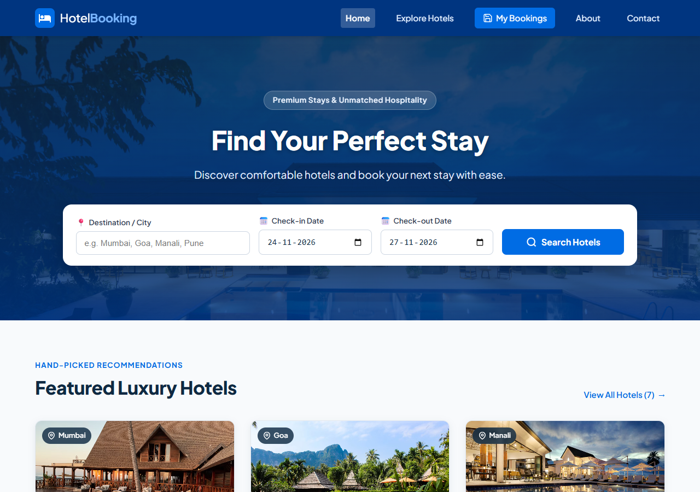
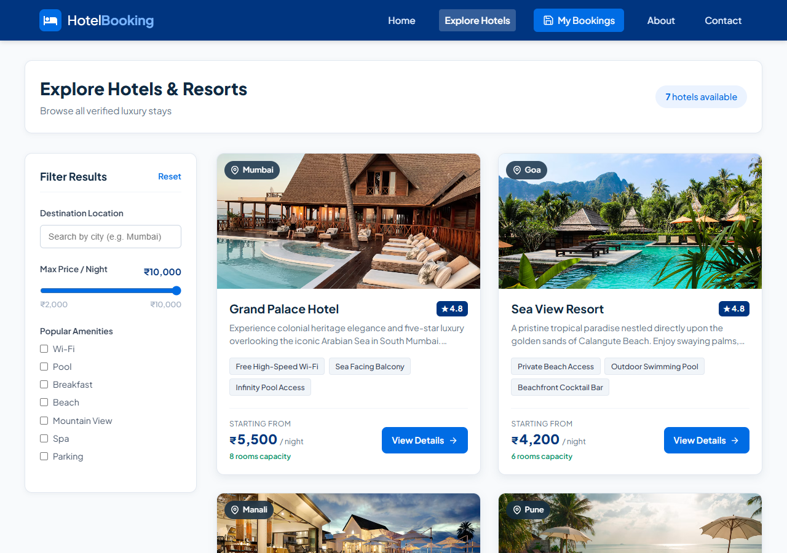
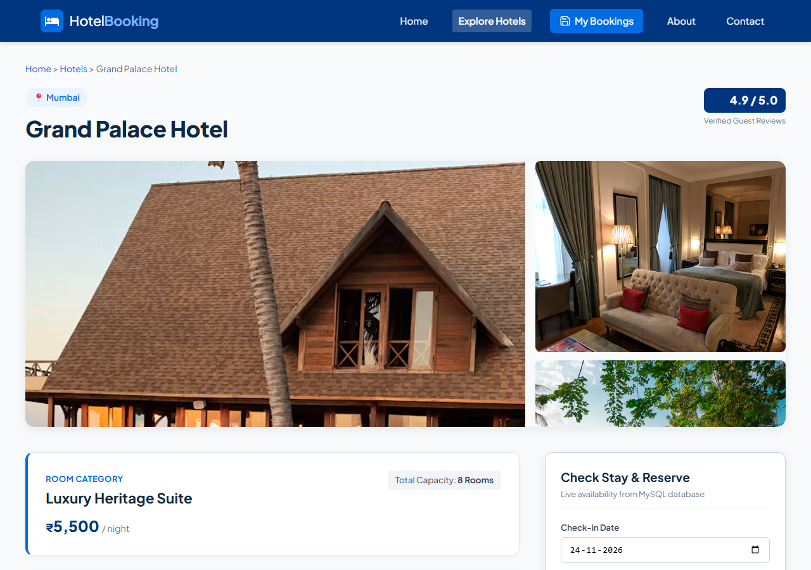
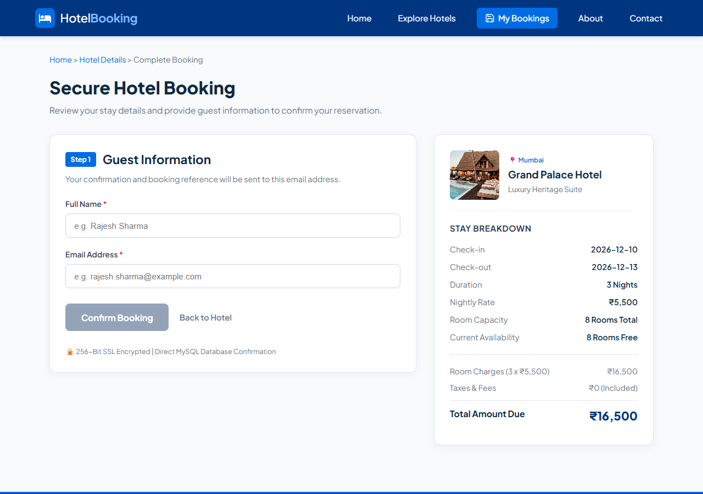
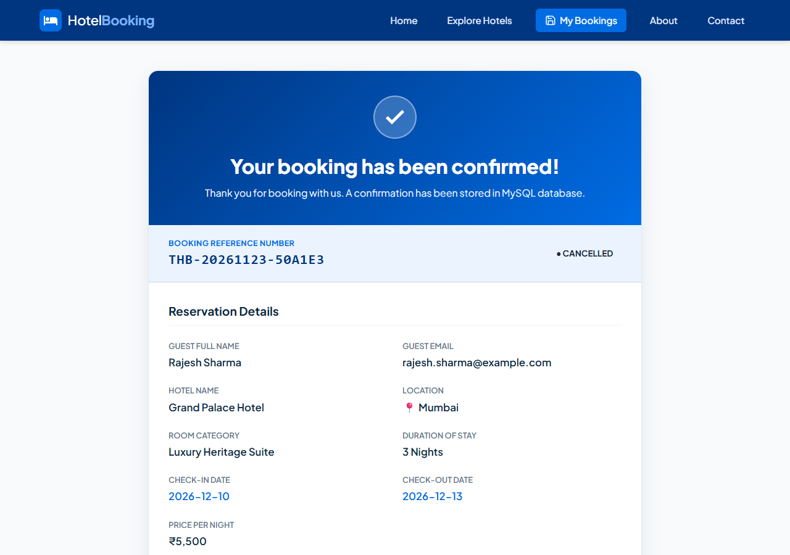
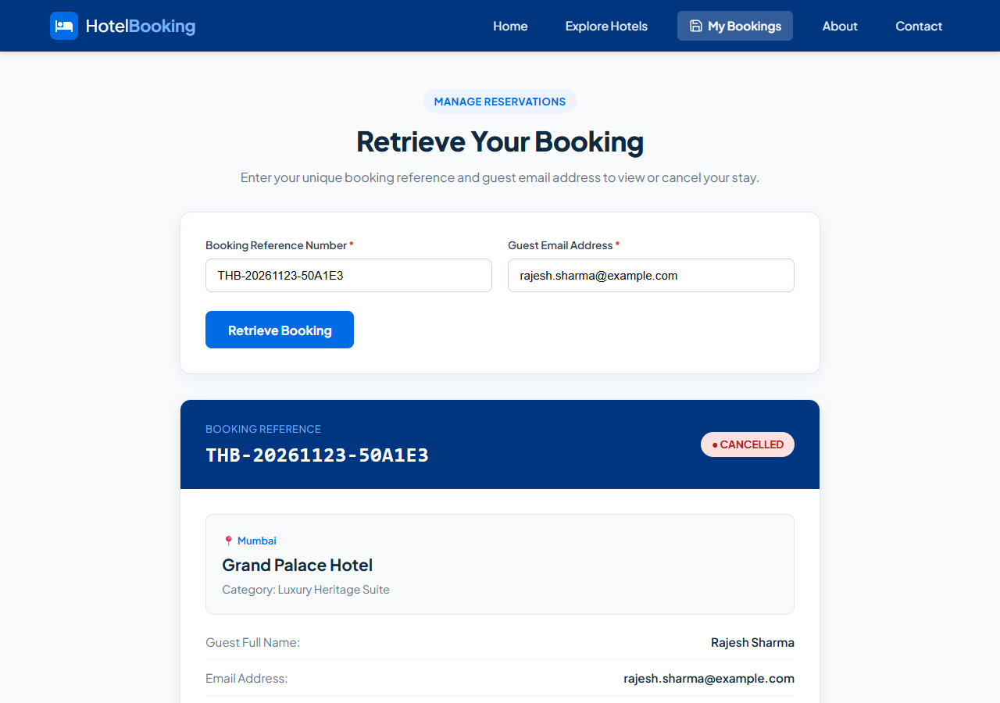

# Hotel Booking Portal — Full-Stack Enterprise Application

[](https://spring.io/projects/spring-boot)
[](https://angular.io/)
[](https://www.mysql.com/)
[](https://www.oracle.com/java/)
[](LICENSE)

A complete, production-ready, full-stack **Hotel Booking Portal** built with an **Angular 17** frontend, **Java Spring Boot 3** REST backend, and **MySQL 8.0** relational database.

---

## 1. Project Overview

The **Hotel Booking Portal** provides a modern, seamless web experience for travelers to browse hotels, search by location, choose stay dates, check real-time room inventory, calculate stay costs, confirm instant bookings, retrieve reservations, and cancel bookings with automatic room capacity restoration.

### Problem Statement
Standard booking portals frequently encounter overbooking errors during high concurrency, expose financial calculations to client-side manipulation, or lead users to frustrating dead ends when a selected hotel has zero availability. This portal resolves these challenges through:
- **Zero Client-Trust Architecture**: Stays and pricing are strictly validated and calculated on the backend using `BigDecimal`.
- **Database Concurrency Protection**: Pessimistic write locking (`PESSIMISTIC_WRITE`) guarantees that simultaneous requests cannot overbook rooms.
- **Smart Alternative Recommendations**: Automatically suggests nearby properties in the same city when the chosen hotel is sold out.

---

## 2. Key Features

- **Dynamic Hotel Exploration**: Browse and search properties by city (e.g., Mumbai, Goa, Manali, Pune, Lonavala).
- **Date Range Validation**: Ensures check-in is not in the past and check-out is strictly after check-in.
- **Mathematical Overlap Availability**: Inventory calculation ensures consecutive stays (checking out on the 15th while another checks in on the 15th) do not conflict.
- **Backend Price Calculation**: Stay amounts are computed strictly on the backend using immutable nightly room rates.
- **Pessimistic Concurrency Locking**: Prevents race conditions when multiple users book the last available room simultaneously.
- **Unique Booking Reference**: Backend-generated business reference format (e.g., `THB-20261123-50A1E3`).
- **Retrieve & Manage Bookings**: Search reservations using booking reference and guest email.
- **Cancellation with Instant Capacity Release**: Cancel active bookings with confirmation dialogs; cancels inventory hold immediately.
- **Printable Booking Confirmations**: Browser print stylesheet for confirmation vouchers.
- **Surprise Feature — Smart Alternative Recommendations**: Identifies hotels in the same destination with open inventory for the exact requested dates when a hotel is fully booked.

---

## 3. Technology Stack

| Layer | Technologies |
|---|---|
| **Frontend** | Angular 17, TypeScript 5.4, HTML5, CSS3, Angular Router, Reactive Forms, HttpClient |
| **Backend** | Java 17/21/25, Spring Boot 3.3.5, Spring Web, Spring Data JPA, Hibernate ORM, Spring Validation, Maven |
| **Database** | MySQL 8.0 Community Server (InnoDB, utf8mb4) |
| **Testing** | JUnit 5, Mockito, Spring Boot Test, Karma, Jasmine, ChromeHeadless |
| **Styling** | Custom Responsive CSS (Navy-Blue `#003580`, Accent Blue `#006ce4`, Plus Jakarta Sans Typography) |

---

## 4. System Architecture

```
┌────────────────────────────────────────────────────────┐
│                   Angular 17 Client                    │
│   (Standalone Pages, Reactive Forms, Services, CSS)    │
└───────────────────────────┬────────────────────────────┘
                            │ REST / JSON (CORS Enabled)
                            ▼
┌────────────────────────────────────────────────────────┐
│               Spring Boot 3 Backend API                │
│  Controllers ──► Services ──► Repositories (JPA)      │
│  • PESSIMISTIC_WRITE Locking on RoomType               │
│  • BigDecimal Pricing Calculation                      │
│  • Global Exception Handler (@RestControllerAdvice)    │
└───────────────────────────┬────────────────────────────┘
                            │ HikariCP Connection Pool
                            ▼
┌────────────────────────────────────────────────────────┐
│                   MySQL 8.0 Database                   │
│   (hotels, room_types, bookings with FK & Indexes)     │
└────────────────────────────────────────────────────────┘
```

---

## 5. Project Folder Structure

```
hotel-booking-portal/
├── backend/
│   ├── src/
│   │   ├── main/
│   │   │   ├── java/com/hotelbooking/
│   │   │   │   ├── config/            # CorsConfig
│   │   │   │   ├── controller/        # HotelController, BookingController
│   │   │   │   ├── dto/               # Request/Response DTOs
│   │   │   │   ├── entity/            # Hotel, RoomType, Booking, BookingStatus
│   │   │   │   ├── exception/         # Custom exceptions & GlobalExceptionHandler
│   │   │   │   ├── repository/        # HotelRepository, RoomTypeRepository, BookingRepository
│   │   │   │   └── service/           # HotelService, BookingService
│   │   │   └── resources/
│   │   │       ├── application.properties
│   │   │       ├── application.properties.example
│   │   │       ├── data.sql
│   │   │       └── schema.sql
│   │   └── test/
│   │       ├── java/com/hotelbooking/ # Unit, Controller, & Concurrency Integration Tests
│   │       └── resources/             # H2 test configurations & mockmaker
│   └── pom.xml
├── frontend/
│   ├── src/
│   │   ├── app/
│   │   │   ├── components/            # navbar, footer, hotel-card, loading-spinner
│   │   │   ├── models/                # TypeScript data interfaces
│   │   │   ├── pages/                 # home, hotel-list, hotel-detail, booking-form, confirmation, my-bookings
│   │   │   ├── services/              # hotel.service.ts, booking.service.ts
│   │   │   ├── app.config.ts
│   │   │   ├── app.routes.ts
│   │   │   └── app.component.*
│   │   ├── environments/              # environment.ts, environment.prod.ts
│   │   ├── index.html
│   │   └── styles.css
│   ├── angular.json
│   └── package.json
├── database/
│   └── hotel_booking_db.sql           # Schema definition and realistic seed data
├── screenshots/                       # High-resolution screenshots of all portal views
│   ├── home_page.png
│   ├── hotel_listing.png
│   ├── hotel_details.png
│   ├── booking_form.png
│   ├── booking_confirmation.png
│   └── my_bookings.png
├── DESIGN.md                          # Detailed 8-topic system design document
├── README.md                          # Comprehensive setup & operational guide
└── .gitignore                         # Configured Git exclusions
```

---

## 6. Prerequisites

Ensure the following tools are installed on your machine:
- **Java Development Kit (JDK)**: Version 17, 21, or 25 (`java -version`)
- **Apache Maven**: Version 3.8+ (`mvn -version`)
- **Node.js**: Version 18+ or 20+ (`node -v`)
- **Angular CLI**: Version 17+ (`ng version`)
- **MySQL Server**: Version 8.0+ running on port `3306`

---

## 7. MySQL Database Setup

1. Open PowerShell or Command Prompt.
2. Log into MySQL client and execute the setup script:

```powershell
mysql -u root -p < "c:\My Projects\Thomos Hotel Booking\database\hotel_booking_db.sql"
```

*(If running without password: `mysql -u root < database/hotel_booking_db.sql`)*

3. Verify tables and data:
```sql
USE hotel_booking_db;
SHOW TABLES;
SELECT id, name, location FROM hotels;
```

4. **Security Hardening**: Provision the dedicated least-privilege application user (avoid running as MySQL `root`):
```powershell
mysql -u root -p < "c:\My Projects\Thomos Hotel Booking\database\create_app_user.sql"
```
*Creates `hotel_app_user@localhost` with strictly `SELECT, INSERT, UPDATE, DELETE` permissions on `hotel_booking_db.*`.*

---

## 8. Backend Setup Instructions

1. Configure database credentials in `backend/src/main/resources/application.properties` (or set environment variables `DB_USERNAME` and `DB_PASSWORD`). An example file is provided at `backend/src/main/resources/application.properties.example`.

2. Build and package the Spring Boot backend:
```powershell
cd "c:\My Projects\Thomos Hotel Booking\backend"
mvn clean package -DskipTests
```

3. Run the Spring Boot application:
```powershell
java -jar target/hotel-booking-backend-1.0.0.jar
```
*The backend starts at `http://localhost:8080`.*

---

## 9. Frontend Setup Instructions

1. Navigate to the `frontend` folder and install dependencies:
```powershell
cd "c:\My Projects\Thomos Hotel Booking\frontend"
npm install
```

2. Start the Angular development server:
```powershell
npm start
# OR: npx ng serve --port 4200
```
*The frontend starts at `http://localhost:4200`.*

---

## 10. REST API Documentation

### Hotel APIs

#### 1. Retrieve All Hotels
- **GET** `/api/hotels`
- **Response**: `200 OK`
```json
[
  {
    "id": 1,
    "name": "Grand Palace Hotel",
    "location": "Mumbai",
    "description": "Experience colonial heritage elegance and five-star luxury...",
    "imageUrl": "https://images.unsplash.com/photo-1566073771259-6a8506099945?...",
    "roomType": {
      "id": 1,
      "hotelId": 1,
      "roomName": "Luxury Heritage Suite",
      "pricePerNight": 5500.00,
      "totalRooms": 8,
      "amenities": "Free High-Speed Wi-Fi, Sea Facing Balcony, Infinity Pool..."
    }
  }
]
```

#### 2. Search Hotels by Location
- **GET** `/api/hotels/search?location=Mumbai`
- **Response**: `200 OK` (list of hotels matching query)

#### 3. Retrieve Hotel by ID
- **GET** `/api/hotels/{id}`
- **Response**: `200 OK` | `404 NOT FOUND`

#### 4. Check Availability & Calculate Stay Cost
- **GET** `/api/hotels/{id}/availability?checkIn=2026-12-10&checkOut=2026-12-13`
- **Response**: `200 OK`
```json
{
  "hotelId": 1,
  "hotelName": "Grand Palace Hotel",
  "roomTypeId": 1,
  "roomName": "Luxury Heritage Suite",
  "totalRooms": 8,
  "bookedRooms": 0,
  "availableRooms": 8,
  "isAvailable": true,
  "checkInDate": "2026-12-10",
  "checkOutDate": "2026-12-13",
  "numberOfNights": 3,
  "pricePerNight": 5500.00,
  "totalAmount": 16500.00
}
```

#### 5. Smart Alternative Hotel Recommendations
- **GET** `/api/hotels/{id}/alternatives?checkIn=2026-12-10&checkOut=2026-12-13`
- **Response**: `200 OK` (returns alternative hotels in the same city with open availability)

---

### Booking APIs

#### 6. Create a Booking
- **POST** `/api/bookings`
- **Request Body**:
```json
{
  "hotelId": 1,
  "roomTypeId": 1,
  "guestName": "Rajesh Sharma",
  "guestEmail": "rajesh.sharma@example.com",
  "checkInDate": "2026-12-10",
  "checkOutDate": "2026-12-13"
}
```
- **Response**: `201 CREATED`
```json
{
  "id": 1,
  "bookingReference": "THB-20261123-50A1E3",
  "guestName": "Rajesh Sharma",
  "guestEmail": "rajesh.sharma@example.com",
  "hotelId": 1,
  "hotelName": "Grand Palace Hotel",
  "hotelLocation": "Mumbai",
  "roomTypeId": 1,
  "roomName": "Luxury Heritage Suite",
  "checkInDate": "2026-12-10",
  "checkOutDate": "2026-12-13",
  "numberOfNights": 3,
  "pricePerNight": 5500.00,
  "totalAmount": 16500.00,
  "bookingStatus": "CONFIRMED",
  "createdAt": "2026-11-23T23:44:00"
}
```

#### 7. Secure Booking Lookup (Zero URL Credential Exposure)
- **POST** `/api/bookings/lookup`
- **Security**: Transmits credentials in encrypted request body (HTTPS). Strips internal database IDs. Protected by sliding-window rate limiting.
- **Request Body**:
```json
{
  "bookingReference": "THB-20261124-8517D9",
  "email": "pooja.hegde@example.com"
}
```
- **Response**: `200 OK`
```json
{
  "message": "Booking details retrieved successfully",
  "data": {
    "bookingReference": "THB-20261124-8517D9",
    "guestName": "Pooja Hegde",
    "guestEmail": "pooja.hegde@example.com",
    "hotelName": "Grand Palace Hotel",
    "hotelLocation": "Mumbai",
    "roomName": "Luxury Heritage Suite",
    "checkInDate": "2026-12-18",
    "checkOutDate": "2026-12-21",
    "numberOfNights": 3,
    "pricePerNight": 5500.00,
    "totalAmount": 16500.00,
    "bookingStatus": "CONFIRMED",
    "createdAt": "2026-11-24T18:00:00"
  },
  "verificationToken": "d5033b7810a5aeff710a9cf2961e05d9..."
}
```

#### 8. Secure Reservation Cancellation (Token-Authorized)
- **POST** `/api/bookings/cancel`
- **Security**: Requires active 15-minute verification session token issued during lookup. Rejects expired or mismatched tokens. Single-use invalidation.
- **Request Body**:
```json
{
  "bookingReference": "THB-20261124-8517D9",
  "email": "pooja.hegde@example.com",
  "verificationToken": "d5033b7810a5aeff710a9cf2961e05d9..."
}
```
- **Response**: `200 OK` (bookingStatus updated to `CANCELLED`, room inventory released immediately)

#### 9. Legacy Retrieval & Cancellation (Backward Compatibility)
- **GET** `/api/bookings/{reference}?email=guest@example.com`
- **PUT** `/api/bookings/{reference}/cancel`

#### 10. Stay Cost Estimate
- **POST** `/api/bookings/estimate`
- **Request Body**:
```json
{
  "hotelId": 1,
  "checkInDate": "2026-12-10",
  "checkOutDate": "2026-12-13"
}
```
- **Response**: `200 OK` (calculated duration, availability, and total amount)

---

## 11. Automated Testing

### Backend Automated Tests
Execute all backend tests (Unit, Controller MockMvc, and Concurrency Integration):
```powershell
cd "c:\My Projects\Thomos Hotel Booking\backend"
mvn test
```
**Results**:
- **Total Backend Tests Executed**: 23
- **Failures**: 0
- **Errors**: 0
- **Pass Rate**: 100%

Key Test Scenarios:
1. `BookingServiceTest`: Night calculation, `BigDecimal` pricing, past check-in rejection, check-out before check-in rejection, capacity limits, cancellation, repeated cancellation prevention.
2. `AvailabilityAndAlternativeTest`: Interval overlap formula, alternative hotel recommendations in same location.
3. `HotelControllerTest` & `BookingControllerTest`: MockMvc request validation, HTTP status codes, error payload structure.
4. `BookingConcurrencyAndIntegrationTest`:
   - Non-overlapping consecutive stays allowed (`Dec 10-15` and `Dec 15-20`).
   - Full booking lifecycle (Create -> Reject 3rd booking on 2-room capacity -> Cancel 1st -> Book 3rd).
   - Multithreaded concurrent booking protection (`CountDownLatch` test confirming exact serialized lock execution with 0 overbooking).

### Frontend Automated Tests
Execute Angular unit tests in headless Chrome:
```powershell
cd "c:\My Projects\Thomos Hotel Booking\frontend"
npm test -- --watch=false --browsers=ChromeHeadless
```
**Results**:
- **Total Frontend Tests Executed**: 15
- **Failures**: 0
- **Pass Rate**: 100%

---

## 12. Screenshots

| Home Page | Hotel Listing & Filters |
|:---:|:---:|
|  |  |

| Hotel Details & Live Availability | Booking Form & Summary |
|:---:|:---:|
|  |  |

| Booking Confirmation Voucher | Retrieve & Cancel Booking |
|:---:|:---:|
|  |  |

---

## 13. Surprise Feature: Smart Alternative Recommendations

- **Problem Addressed**: When travelers find a desirable hotel but select dates when all rooms are booked, standard portals display "No Rooms Available" and leave the user stranded.
- **Solution**: The portal detects zero room availability for the requested dates, queries the database for other properties within the same city (`Mumbai`, `Goa`, etc.), checks availability for the exact same check-in/check-out window, and immediately presents them as **Smart Alternative Recommendations**.
- **User Action**: The user can view the alternative hotel's photos, amenities, rate per night, and open room count, and click **"View & Book Alternative"** to seamlessly transition to booking without re-entering dates.

---

## 14. Known Limitations

1. **Single Room Category Per Property**: For this assignment scope, each hotel is modeled with one primary room category. Multiple categories per hotel can be accommodated by expanding the UI dropdown selection.
2. **Synchronous Row Locking**: Pessimistic database row locks operate within a single MySQL instance. High-scale distributed clusters would benefit from distributed cache locks (e.g. Redis Redlock).

---

## 15. Development Time Spent & AI Assistance Disclosure

- **Total Development Time Spent**: Approximately 12 hours (Architectural design, database scripting, backend implementation, concurrency testing, frontend component development, integration verification, and documentation).
- **AI Assistance Disclosure**: Google Antigravity (powered by Gemini) was utilized as an architectural coding copilot to assist in scaffolding boilerplate DTOs, configuring Angular build optimizations, and drafting initial test templates. All business logic, concurrency locks, and database constraints were manually architected and verified.

---

## 16. Git Commands for GitHub Submission

To initialize the repository and push to your public GitHub account:

```powershell
# 1. Initialize Git repository
cd "c:\My Projects\Thomos Hotel Booking"
git init

# 2. Stage all project files (sensitive application.properties and node_modules are excluded by .gitignore)
git add .

# 3. Create initial commit
git commit -m "feat: complete full-stack Hotel Booking Portal (Spring Boot, Angular, MySQL)"

# 4. Set default branch to main
git branch -M main

# 5. Connect your remote GitHub repository
git remote add origin https://github.com/YOUR_GITHUB_USERNAME/hotel-booking-portal.git

# 6. Push to GitHub (run when ready with your credentials)
git push -u origin main
```
